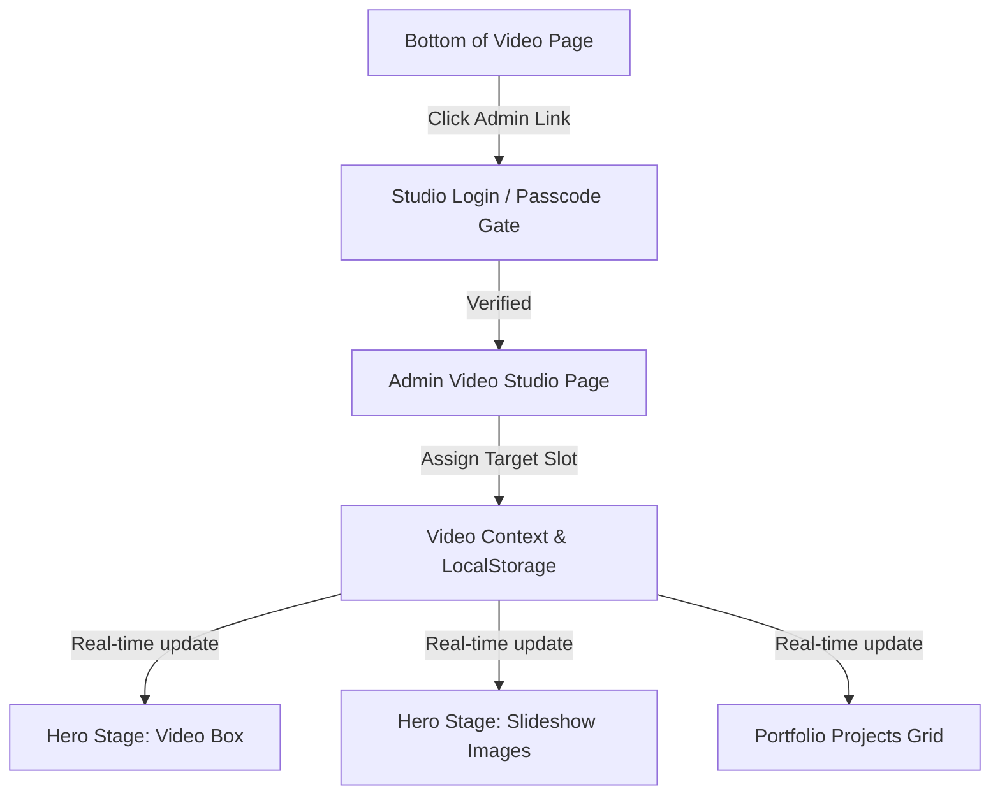

# Video Studio Admin & Video Management Implementation Plan

## 1. Overview & Objective
Enable dynamic video management for the portfolio by:
1. Adding a discreet, stylish **Admin Portal link** at the bottom of the Video Editing page.
2. Connecting it to the **Studio Login / Passcode Gate** (reusing or aligning with the existing `sessionStorage` authentication pattern).
3. Creating a new **Video Management Studio (`AdminVideoPage`)** that lets you:
   - Paste embed links (YouTube/Vimeo) or upload video files/thumbnails.
   - Choose exactly **where** in the website the video or image appears (Hero Foreground Video, Hero Slideshow Backdrop, or Portfolio Showcase Projects).
   - Persist changes dynamically using a dedicated `VideoContext` (with `localStorage` and fallback defaults), so updates show immediately on the live site without editing code.

---

## 2. Architecture & Data Flow

---

## 3. Step-by-Step Implementation Steps

### Phase 1: Context & State Management (`src/context/VideoContext.jsx`)
Create a persistent state provider similar to `GraphicsContext`:
* **Data Model**:
  * `heroVideo`: `{ url: "...", type: "youtube" | "vimeo" | "file", title: "..." }`
  * `heroSlides`: Array of image URLs for the background slideshow.
  * `projects`: Array of portfolio items `{ id, title, category, videoUrl, thumb }`.
* **Actions**:
  * `updateHeroVideo(url, title)`
  * `addHeroSlide(imageUrl)` / `removeHeroSlide(index)`
  * `addProject(projectData)` / `updateProject(id, projectData)` / `deleteProject(id)`
  * `resetToDefaults()`

---

### Phase 2: Navigation & Routing (`src/App.jsx`)
* Add `#video-admin` (or `#studio-video`) hash route support to `App.jsx`.
* Render `AdminVideoPage` when `#video-admin` is active.
* Wrap the app with `<VideoProvider>` alongside `<GraphicsProvider>`.

---

### Phase 3: Bottom Route Link in `videoEditingPage.jsx`
* At the bottom of `videoEditingPage.jsx` (inside the footer or discreet copyright bar):
  * Add a subtle, editorial link: **"STUDIO PORTAL / VIDEO ADMIN"** pointing to `#video-admin`.
  * Styled with clean hover feedback fitting the dark luxury palette.

---

### Phase 4: Passcode Authentication
* Check `sessionStorage.getItem("philip_studio_auth")`.
* If unauthenticated, show the minimal passcode modal (reusing the studio passcode `2024` or custom studio pin).
* Once authenticated, display the full admin management suite.

---

### Phase 5: New Page: `AdminVideoPage.jsx` & `AdminVideoPage.css`
A sleek, tabbed management dashboard:
1. **Tab 1: Hero Media Slots**:
   - **Hero Foreground Video**: Input a YouTube, Vimeo, or direct video URL with instant preview.
   - **Hero Slideshow Backdrop**: Add new slide URLs/images, preview existing slides, delete or reorder them.
2. **Tab 2: Portfolio Showcase Projects**:
   - Form to add/edit cards:
     - Target Title & Category
     - Video Embed URL
     - Custom Thumbnail Image URL / Upload
   - Existing project list with quick **Edit**, **Delete**, or **Reorder** buttons.
3. **Tab 3: Quick Preset / Reset**:
   - Export configuration as JSON.
   - One-click reset to original default videos and slides.

---

### Phase 6: Connect `videoEditingPage.jsx` to `VideoContext`
* Replace hardcoded `HERO_SLIDES` and `PORTFOLIO_PROJECTS` with live data from `useVideo()`.
* Hero video iframe and backdrop slides immediately react to any changes saved in the admin page.

---

## 4. Verification Checklist
- [ ] Bottom link navigates cleanly to `#video-admin`.
- [ ] Passcode gate blocks unauthorized visitors.
- [ ] Changing the hero video link updates the video in the hero stage.
- [ ] Adding/removing slideshow backdrop images updates the background crossfade.
- [ ] Adding a new portfolio project immediately displays it in the portfolio grid with functional video playback.
- [ ] Works cleanly across mobile and desktop.
